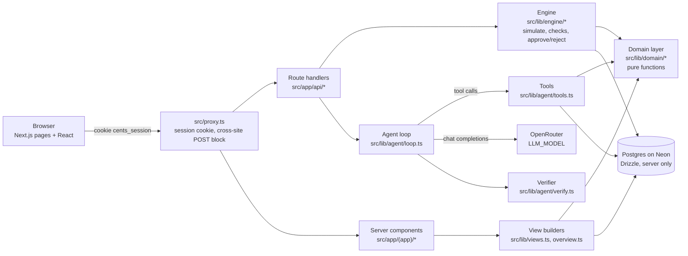
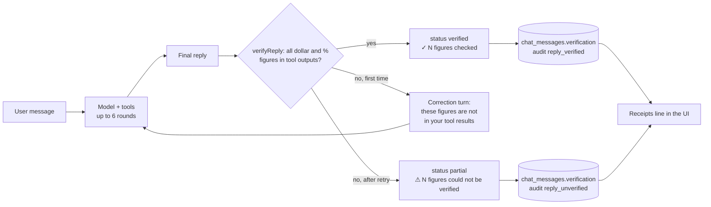
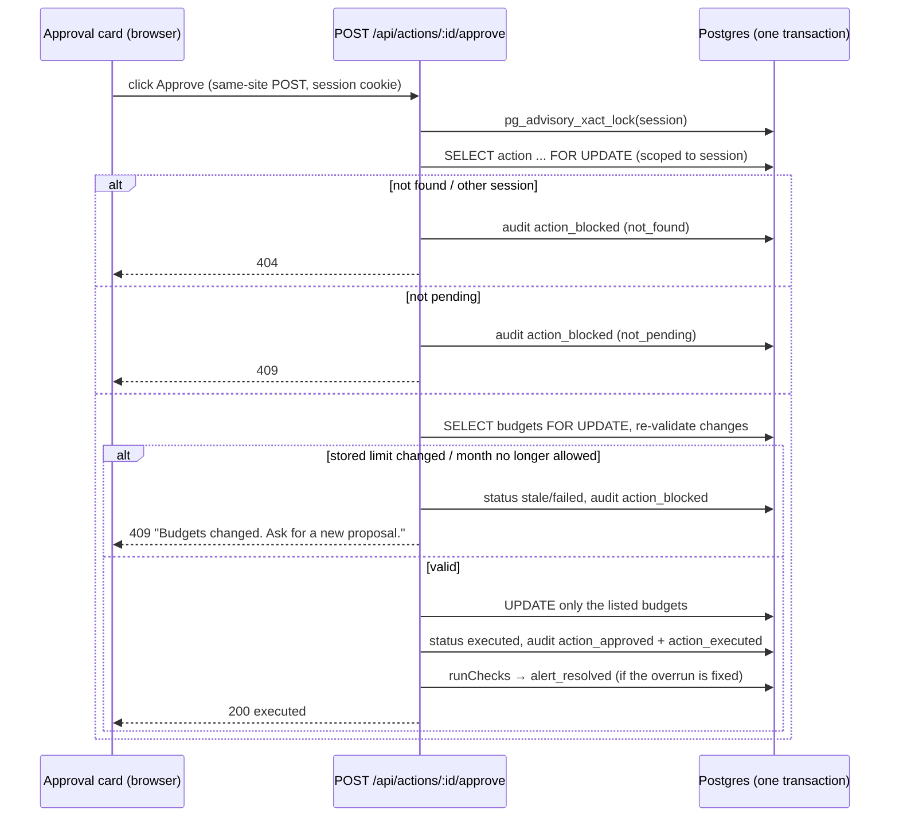

# Cents: Technical Overview

This document describes only what is implemented. File paths point at the code (and tests) behind each statement.

## 1. Architecture

- **One deployable:** a Next.js 16 app (App Router) holds the pages and the API routes.
- **The browser never talks to the database or the LLM.** Every query and model call runs server-side.
- **Domain layer** (`src/lib/domain/`): pure functions over plain data (integer cents, ISO dates). Every figure on screen and every tool output comes from here, and this is where unit tests concentrate.
- **Simulated today:** all business dates use `simToday()` (`src/lib/sim.ts`, from `SIM_TODAY`), never the real clock.

**Stack:**
- Next.js 16.4, React 19.3, TypeScript, Tailwind 4, shadcn/ui, Recharts.
- Drizzle ORM with `postgres-js` (pooled URL, `prepare: false`). Neon Postgres in Singapore.
- LLM via the `openai` SDK pointed at OpenRouter (`src/lib/agent/llm.ts`: 45 s timeout, 1 retry).
- Tests: Vitest on PGlite, using the same migrations (`tests/helpers/db.ts`), and Playwright.

## 2. Data model

10 tables (`src/lib/db/schema.ts`, migrations in `drizzle/`). Every row belongs to a session, and every query filters by `session_id`.

| Table | Purpose |
|---|---|
| `sessions` | One per visitor (anonymous cookie). `epoch` increments on reset. |
| `accounts` | The simulated checking account (opening balance in cents). |
| `transactions` | Income, expenses and transfers (`amount_cents` signed bigint, `category`, `merchant`, `source` seed/simulated, unique idempotency key per session). |
| `budgets` | Limit per category per month (`YYYY-MM`). The seed has October and November. |
| `bills` | Recurring bills with due date and paid/unpaid status. |
| `alerts` | Rule alerts with `facts` (jsonb), a dedupe key, and status active/resolved/dismissed. |
| `agent_actions` | Budget-change proposals: `changes` jsonb, `rationale`, `origin` assistant/alert, `status`, `result`. Also **`meta`** (A6): the server-computed overrun-fix split. |
| `audit_log` | Append-only event log. No foreign key, so it survives resets. Uses `clock_timestamp()` ordering. |
| `chat_messages` | The visible thread. Also **`verification`** (A4: the grounding check) and **`turn_ms`** (A5). |
| `tool_calls` | Every tool call: input, output, ok, duration, `message_id`. Inserted with `clock_timestamp()` so the order survives. |

- **Money:** always integer cents (`src/lib/domain/money.ts`). It's formatted to dollars only at the display edge.
- **RLS:** enabled on every table with **no policies** (`drizzle/0001_enable_rls.sql`). The app connects server-side as the owner, and nothing else can read the tables.
- **Seed** (`src/seed/generate.ts`): deterministic (mulberry32, seed 20261015). It is copied per session on first visit (`src/lib/db/sessions.ts`, `seed-clone.ts`) and copied again on reset.

## 3. Core financial formulas

All of these live in `src/lib/domain/`, with tests in `tests/unit/`.

| Formula | Definition | Code |
|---|---|---|
| Balance | Opening balance + sum of all transaction amounts | `summary.ts` |
| Month-to-date income / spending | Income = type `income`. Spending = type `expense` (transfers to savings are money out, not spending). This month, up to today. | `summary.ts` |
| Net cash flow | Money in − money out. Equals the month's balance change, so "ahead this month", the balance delta and Net always agree. | `summary.ts` |
| Budget utilization | Category spend this month ÷ limit. Warning at 80–100%, overrun above 100%. | `budgets.ts`, `alerts.ts` |
| Upcoming bill alert | Unpaid and due within 7 days (inclusive) | `alerts.ts` |
| Unusual spending | One expense > 3× the 90-day median in its category **and** > $50 | `alerts.ts` |
| Disposable funds | Balance − unpaid bills due by the next income date (the 14th) − remaining essential budget (Housing, Utilities, Groceries, Transport, Health), where remaining = max(limit − spent − that category's unpaid bills this month, 0) | `affordability.ts` |
| Affordability of X | Affordable when X ≤ disposable funds. Always reports the balance and disposable funds after the purchase, the bills counted and the assumptions. | `affordability.ts` |
| Overrun quick fix (rule engine) | Overage rounded **up** to $5, taken from the discretionary category with the most remaining budget that can cover it. Otherwise none. | `proposals.ts` |

### Addendum algorithms

**Recurring charges** (`recurring.ts`, `find_recurring_charges`):
1. Takes expenses in the last N months (default 6), excluding Income and Savings.
2. Groups them by normalized merchant name, keeping charges within ±10% of the group's median. Known bills keep every charge.
3. Requires at least 3 occurrences on a regular cadence: weekly (6–8 days apart), monthly (26–35) or yearly (355–375).
4. Housing and Utilities count as bills; everything else is a subscription.
5. Monthly equivalents: weekly × 52/12, yearly ÷ 12.

**Bill analysis** (`bills-analysis.ts`, `analyze_bills`):
- Uses the paid history in the window: average, min, max and last paid.
- Compares the next unpaid amount (or the last paid one) with the average, as a delta and a percentage to one decimal.
- **Unusual** when |delta| × 100 ≥ 15 × average. This is an exact integer comparison.
- **Trend:** the mean of the newest half against the oldest half, ±5% = flat.

**Overrun fix** (`overrun-fix.ts`, `plan_overrun_fix`):
1. Overage = (spent − limit) rounded up to $5. Nothing is needed if the category isn't over. Essential categories are never rebalanced.
2. **Sources:** discretionary categories other than the target, under 80% used. Their room = limit − spent − that category's unpaid bills this month − max($10, 10% of limit), in whole dollars. Rooms under $5 are skipped.
3. Take from the sources, largest room first, until the overage is covered (*covered now*).
4. **Carry** the rest to next month's limit for the same category, down to a floor of max($20, 30% of that limit).
5. Uncovered = overage − covered now − carried.
6. **Change set:** raise this month's target by covered + carried, lower each source by what was taken, and lower next month's target by the carried amount.

Invariants, each unit-tested in `tests/unit/overrun-fix.test.ts`:
- (a) no essential category appears in the change set
- (b) no source ends below spent + upcoming bills + buffer
- (c) covered + carried + uncovered = overage
- (d) the net change is $0 whenever nothing is uncovered
- (e) the change set passes the existing proposal validator, across both months
- (f) the result is deterministic

**Category history and pace** (`category-history.ts`, `get_category_history`):
- Covers the last N full months (default 3). The seed has no stored past budgets, so past months are compared with this month's limit, and the tool says so (`limit_basis`).
- **Pace** = (spent ÷ limit) ÷ (days elapsed ÷ days in month) × 100. 100 means exactly on pace.
- **Projected month end** = spent ÷ days elapsed × days in month. For fixed categories (Housing, Utilities, Subscriptions) it is max(spent, limit) instead.
- **Suggested next-month limit**, measured against next month's stored limit and rounded **up** to $10:

| Case | Suggestion |
|---|---|
| Fixed category | Keep the limit, unless next month's known bills exceed it; then their sum. |
| Average > limit | Meet halfway: limit + (average − limit) ÷ 2 (`chronically_over`). |
| Average < 70% of limit | max(average × 1.15, 70% of limit) (`consistently_under`). |
| Otherwise | Keep (`on_track`). |
| Essential category | Never cut (`essential_kept`). |

The Budgets page's pace line comes from the same function (`paceLine`).

## 4. The agent

**Loop** (`src/lib/agent/loop.ts`):
- The system prompt (`prompt.ts`, cached prefix) plus the last 20 messages plus the tool definitions go to the model.
- Tool calls run server-side and their results are fed back, for up to 6 rounds. After that a text answer is forced.
- The user message, the reply, the verification and the turn time are stored together. Every tool call is logged in `tool_calls`, and an audit `chat_message` entry records the model, the tools used, token counts and cost.

**Tools** (`src/lib/agent/tools.ts`):
- Every input is validated with a strict zod schema.
- Money comes back as `{cents, usd}` and dates as `{iso, label}`, so the model only ever quotes values and never formats or computes them.
- Merchant names sit under `data`, marked as untrusted.

| Tool | Kind | What it returns |
|---|---|---|
| `get_account_summary` | read | Balance, month-to-date income, spending, transfers and net, balance change % |
| `get_transactions` | read | Filtered list, totals for all matching rows, per-merchant totals |
| `get_spending_by_category` | read | Category totals for a month, or the last N days |
| `get_budget_status` | read | Limit, spent, remaining and utilization per category |
| `get_upcoming_bills` | read | Unpaid bills due in N days, plus the total |
| `compare_monthly_spending` | read | Two months per category, with changes |
| `check_affordability` | read | Disposable funds, the bills counted, after-purchase figures |
| `find_recurring_charges` | read | Subscriptions and bills, monthly and yearly totals (A2) |
| `analyze_bills` | read | History, average, upcoming amount, % against the average, trend, unusual flag (A3) |
| `plan_overrun_fix` | read | Covered now, carried, uncovered, and the change set (`propose_with`) (A6) |
| `get_category_history` | read | Monthly history, pace, suggested next limits (`propose_with`) (A7) |
| `get_proposals` | read | Live proposal statuses and counts (A1) |
| `propose_budget_adjustment` | proposal | Creates a **pending** proposal. The server fills in the old limits, validates, and checks `target_savings_cents` exactly. |

There is no approve, execute, delete or SQL tool (enforced by `tests/security/security.test.ts`).

**Speed** (A8; see `docs/PERF.md`):
- The session's rows are loaded once per turn as a snapshot, started at the beginning of the turn so it runs behind the first model call.
- Read tools compute from that snapshot. Writes and `get_proposals` read the database.
- Read tools requested in the same model response run in parallel. Proposals run after them, one at a time.

### Output verification (A4)

Every assistant reply passes through `verifyReply` (`src/lib/agent/verify.ts`) before it is stored or shown.

1. **Extract** dollar amounts (`$1,234.56`, `$900`, `−$60`, `-$60.00`) and percentages (`88%`, `6.9%`, `12 percent`), counting each distinct figure once.
2. **Collect the allowed values** by walking every tool output from this turn:
   - every number under a key ending in `cents`
   - every `$` or `%` inside a string
   - numbers under keys containing `pct`, `percent` or `utilization`
   - figures in the user's own message, with or without a symbol
3. **Match:** dollars within $0.01. Percentages within ±0.1, or a whole-number percentage equal to the rounded source. Matching ignores sign.
4. If anything is unmatched, the model gets **one** correction turn listing the ungrounded figures. Whichever attempt has fewer unmatched figures is kept. A reply is never dropped silently.
5. The result is stored on the message (`verification`) and audited as `reply_verified` or `reply_unverified`, with counts only. It is also summarized in `/api/evidence`.

**Measured:** 16 of 16 eval replies with figures verified (`docs/AI_EVAL.md`). Unit tests are in `tests/unit/verify.test.ts`, and the retry path in `tests/api/agent.test.ts`.

### Receipts panel (A5)

- `buildTrace` (`src/lib/agent/trace.ts`) turns a message's `tool_calls` into rows of `{tool, label, input_summary, ok, duration_ms, key_figures}`.
- Each tool has a friendly label (for example, "Ran affordability check") and a `summarizeForTrace` that picks up to 4 key figures.
- Only labels, small input chips and pre-formatted figures leave the server: no IDs and no raw outputs.
- **Data flow:** the POST `/api/chat` response builds the trace from the turn's own log. GET `/api/chat` (`loadChat`) rebuilds it from `tool_calls` by `message_id`. The two produce the same trace in the same order (tested in `tests/api/trace.test.ts`).
- **UI:** `src/components/chat/turn-receipts.tsx` shows "✦ N steps · ✓ N figures checked · 4.1s ▾", which expands to one row per tool.

## 5. Core scenario data flow

1. **Simulate** (`POST /api/simulate`, `src/lib/engine/simulate.ts`):
   - zod-validated, with an idempotency key, inside a per-session advisory lock.
   - Inserts the transaction, then runs `runChecks`.
2. **Checks** (`src/lib/engine/checks.ts`):
   - Evaluates every alert rule against the current data.
   - Creates new alerts (deduplicated), resolves alerts whose condition no longer holds, and keeps dismissed alerts dismissed.
   - For an overrun with a single possible move, it creates an `origin: alert` proposal ("Move $25 to Dining").
3. **Worth a look:**
   - Shows the top active alert.
   - For a discretionary overrun with no single move, it shows **"Let the agent fix it"**. That button sends "Fix my {category} overrun for {Month}." to the chat.
   - The model then calls `plan_overrun_fix`, then `propose_budget_adjustment` with exactly the returned changes, in one turn.
4. **Proposal:** the server attaches the overrun split (`agent_actions.meta`), but only when the proposal is exactly that turn's plan. The approval card groups rows by month, and states "Rebalances limits across October and November. It doesn't undo the spending."
5. **Approve / reject:** a button calls `POST /api/actions/:id/approve` or `/reject` (see the sequence below). After an approval, `runChecks` resolves the overrun alert.
6. **Log:** every step writes to `audit_log`:
   - `transaction_simulated`, `alert_created`, `action_proposed`, `chat_message`, `reply_verified`, `action_approved`, `action_executed`, `alert_resolved`.
   - `/api/evidence` exports the session's audit log, tool calls, proposals, alerts and verification stats.

## 6. Approval workflow

- Code: `src/lib/engine/actions.ts`. Tests: `tests/api/actions.test.ts`, plus `tests/e2e/security.spec.ts` for concurrent duplicate approvals.
- Two-month proposals (October and November) go through the same path, and the stale check covers both months.

## 7. Security architecture (summary)

The full list is in `docs/SECURITY.md`. In short:
- Anonymous httpOnly session cookies, with every query scoped by `session_id`.
- RLS with no policies, and a server-only database.
- zod on every API input and tool input.
- No approve tool for the AI, and approval only through a same-site button POST.
- An append-only audit log.
- Prompt-injection defenses: data is labelled as data, the action surface is narrow, and there's an injection eval.
- Live output verification.
- Per-session and global chat limits, plus caps on new sessions and on simulated transactions.
- Security headers and a cross-site POST block.
